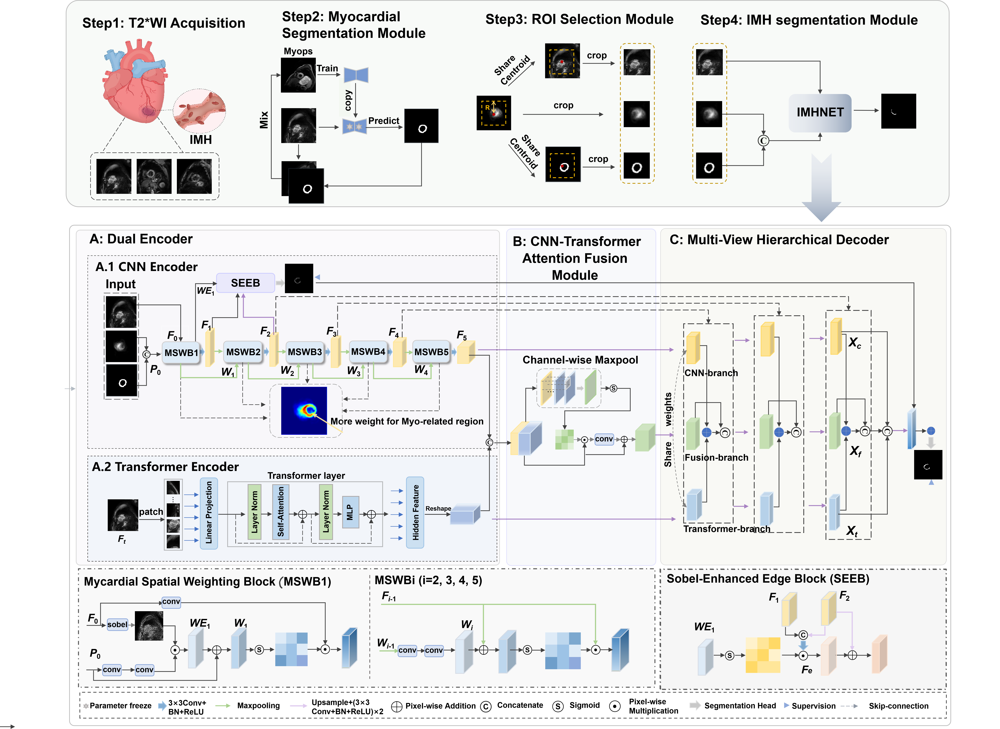

## 1. Overview

T2\*IMH is a cardiac magnetic resonance (CMR) dataset developed for the
segmentation of intramyocardial hemorrhage (IMH) in patients with ST-segment
elevation myocardial infarction (STEMI) after percutaneous coronary
intervention (PCI).




## Usage

### Dataset

Organize the dataset as follows. `--root_path` must point to `data/re_kfold` in this example:

```text
data/re_kfold/
├── split_data/                       # Grayscale MR images
│   ├── split_train.png               # Shared spatial prior for the selected fold
│   └── k_1/
│       ├── train/
│       │   └── case_001/
│       │       ├── slice_001.png
│       │       └── slice_002.png
│       ├── val/
│       │   └── case_002/
│       │       └── slice_001.png
│       └── test/
│           └── case_003/
│               └── slice_001.png
├── split_label/                      # Ground-truth IMH masks
│   └── k_1/
│       ├── train/case_001/...
│       ├── val/case_002/...
│       └── test/case_003/...
├── split_myo/                        # Myocardium masks used as model input
│   └── k_1/
│       ├── train/case_001/...
│       ├── val/case_002/...
│       └── test/case_003/...
└── split_edge/                       # IMH boundary masks for edge supervision
    └── k_1/
        ├── train/case_001/...
        ├── val/case_002/...
        └── test/case_003/...
```

### Train

```bash
python temp_all_2d.py --root_path "./data/re_kfold" --fold 2 --batch_size 4 --max_epochs 150 --base_lr 0.0001 --img_size 224 --vit_name ViT-B_16 --out_path "./output/2d_all"
```

### Predict and evaluate

```bash
python Test_2d_dice.py --root_path "./data/re_kfold" --fold 2 --checkpoint "./output/2d_all/best_model_2d_all_dice_k2_new.pth" --out_path "./output/2d_all/fold_2" --vit_name ViT-B_16 --img_size 224 --batch_size 1 --threshold 0.5 --save_predictions 1
```

